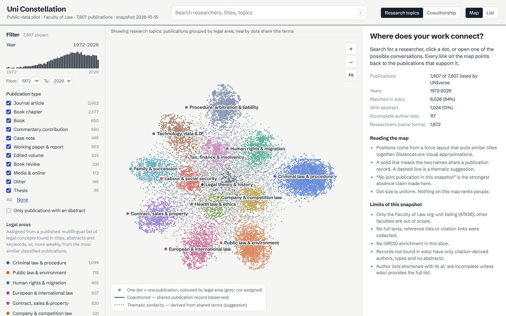
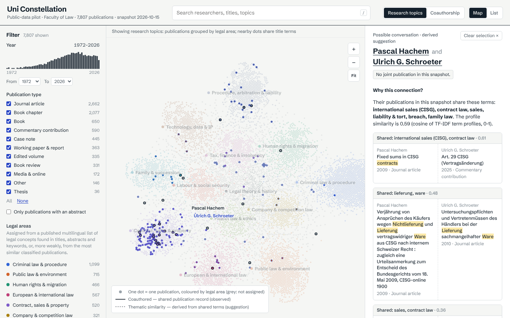
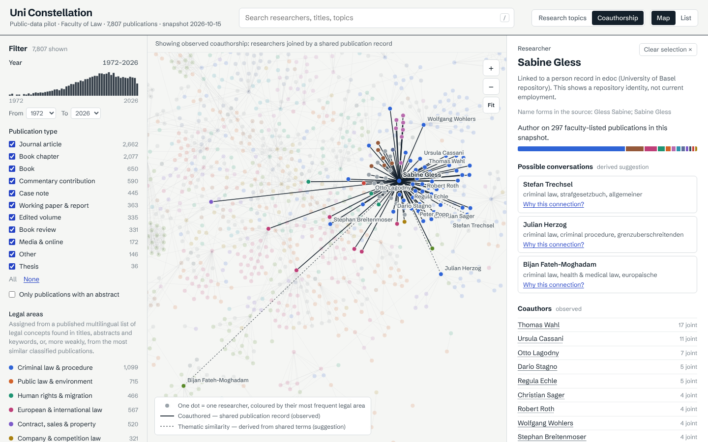
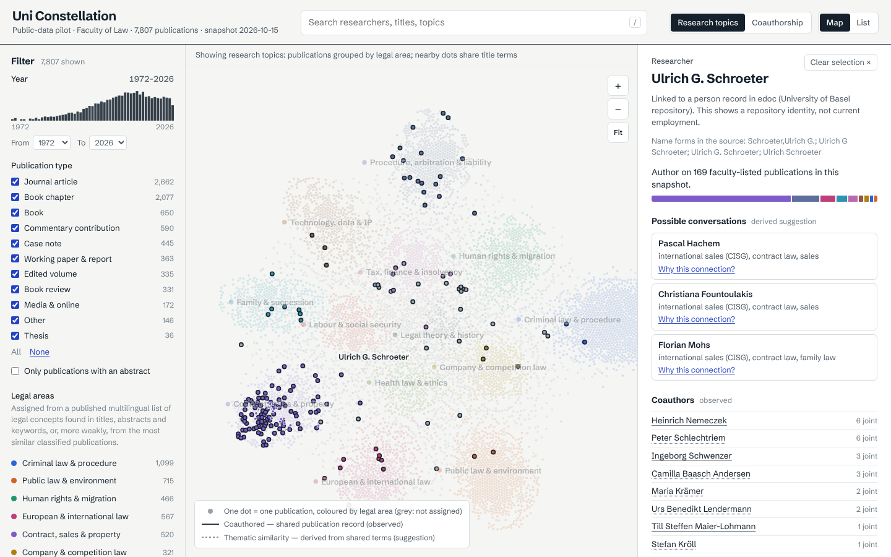
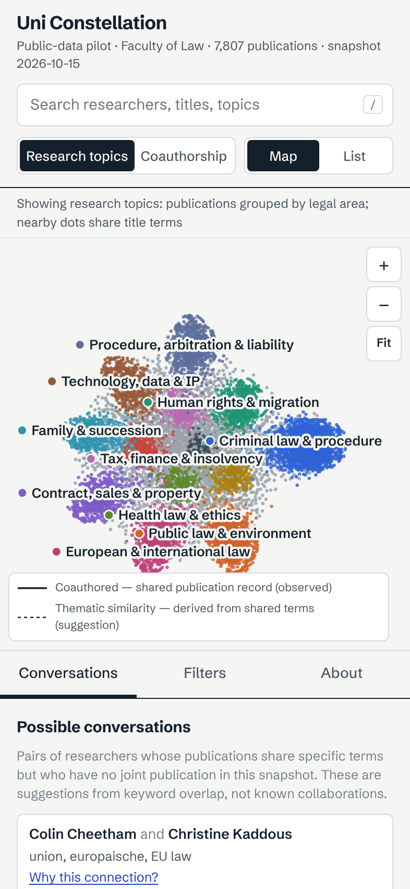

# Uni Constellation

**Public-data pilot · Faculty of Law · 7,807 publications · snapshot 2026-10-15**

An explorable research map of University of Basel Faculty of Law publications. It is built to help a researcher answer one question: *where does my work connect with other people's, and which conversations might be interesting?*



This is **not an official UNIverse product**. It is built only from public metadata: the UNIverse Faculty of Law publication listing and the edoc repository. An authorised UNIverse integration is planned, not connected.

## What you can do

- **Explore the map.** One dot is one publication, coloured by legal area. Nearby dots share title or abstract terms. Pan and zoom with the mouse, or use `+` / `−` / arrow keys / `0` to fit.
- **Search** researchers, titles and topics (`/` focuses search; arrow keys and Enter select).
- **Filter** by year (drag on the histogram or use the selects), publication type, and abstract availability. The current selection is kept when filtering, and an empty state explains what to change.
- **Inspect a publication:** full title, linked authors, container, edoc abstract when available, DOI and edoc links, related work with shared terms, missing-data notes, and the original source citation.
- **Inspect a researcher:** identity status, publications in this snapshot, their legal-area mix, observed coauthors, and possible conversations.
- **Switch relationship mode:** *Research topics* (publications) or *Coauthorship* (researchers joined by shared publication records). The active mode is always labelled.
- **Possible conversations → "Why this connection?"** shows the two people, the shared terms, up to three pairs of their publications with the terms highlighted, the method, and "No joint publication in this snapshot."
- **List view:** the same filtered data without the graph, for keyboard and screen-reader use.
- Solid lines mean **observed coauthorship**. Dashed lines mean **derived thematic similarity**. Dot size is uniform, and nobody is ranked.

| | |
|---|---|
|  |  |
|  |  |

## Commands

Requirements: Node 22+, Python 3.11+ with `numpy` (the pipeline uses only the standard library plus numpy).

```bash
npm install
npm run dev          # http://localhost:5173 — reads the committed JSON in data/
npm run build        # static site in dist/, base path /uni-constelation/
npm run preview      # serve dist/ at http://localhost:4173/uni-constelation/
npm test             # parser + identity fixtures, then data-contract validation
npm run test:e2e     # Playwright: builds, previews and tests desktop + mobile flows
npm run crawl        # bounded crawl, 700 records (README pilot bound)
npm run crawl:full   # whole Faculty of Law listing (used for the committed snapshot)
npm run graph        # rebuild publications/researchers/graph/coverage + layout from data/raw
npm run validate     # check IDs, references and evidence only
```

The app needs no server, login, API key or runtime crawling. `dist/` is a plain static site. GitHub Pages is an optional later destination and is not configured here: no deployment workflow or scheduled crawl exists.

Crawls cache every response in `.cache/http/` (gitignored), so an interrupted crawl resumes. `python3 scripts/crawl.py --offline` rebuilds the raw files from cache without network access.

## Data snapshot (2026-10-15)

| | |
|---|---|
| Source-reported total (UNIverse listing) | 7,807 |
| Unique publications captured | **7,807** (16 pages of 500, no duplicates, stopped at source total) |
| Years | 1972–2026 |
| Matched in edoc | 6,526 (84%): 6,496 via linked handle, 2 via DOI, 28 via title+year+author |
| Not matched in edoc | 1,281 (citation-only: parsed authors, inferred type, no abstract) |
| With abstract (from edoc) | 1,024 (13%) |
| Author lists incomplete ("et al.", no edoc list) | 117 |
| Researcher identities | 1,672 name identities: 331 linked to an edoc person record, 1,304 name-only, 29 initials-only, 8 single-name |
| Relationships | 3,860 coauthorship pairs (observed), 21,089 publication similarity links (derived), 10,868 author-of links |
| Possible conversations | 192 researcher pairs, each with ≥ 1 publication pair sharing ≥ 2 terms |

Full figures are in [`data/coverage.json`](data/coverage.json). The method, parameters and identity rules are in [`docs/DATA_METHOD.md`](docs/DATA_METHOD.md), and checks and results are in [`docs/VALIDATION.md`](docs/VALIDATION.md).

**Scope note:** the original brief ([`docs/BRIEF.md`](docs/BRIEF.md)) set a 700-record bound for the first slice. At the requester's explicit instruction, the committed snapshot captures the whole listing (7,807 records, 16 listing requests and 254 edoc search requests at about 1 request/s). `npm run crawl` still defaults to the 700 bound.

### Files

```
scripts/crawl.py                 bounded, resumable collection (source adapters in scripts/unicon/sources/)
scripts/build_graph.py           deterministic normalisation, identities, TF-IDF, areas, edges, suggestions, coverage
scripts/layout.mjs               deterministic d3-force layouts → data/layout.json
scripts/validate.py              data-contract checks
data/raw/universe-listing.json   original citation HTML + links per UNIverse record, page log
data/raw/edoc-enrichment.json    extracted edoc fields per match, unresolved reasons
data/publications.json           publication records (original citation kept in rawCitation)
data/researchers.json            researcher identities (local ids, edoc authority where available)
data/graph.json                  legal areas, edges (author-of / coauthorship / thematic-similarity), suggestions
data/coverage.json               counts, gaps and exclusions
src/                             React + TypeScript + D3 app (canvas map + SVG labels)
```

## Limitations

- **Coverage:** only the Faculty of Law org-unit listing. Being listed there means a publication was attributed to the faculty in UNIverse. It does **not** confirm that every author is or was Basel staff, and external coauthors are marked as name-only identities.
- **Text basis is thin:** 87% of publications have no abstract, so similarity mostly rests on titles. Similarity is TF-IDF keyword overlap with a small hand-made DE/EN/FR concept lexicon. It is not semantic understanding, and terms outside the lexicon don't cross languages.
- **Legal areas are approximate:** 62% are assigned from lexicon concepts, 17% from similar publications (weaker evidence, labelled as such), and 21% are left unassigned.
- **Identities:** names are merged only through edoc authority IDs or exact full-name equality. Initials are never merged with full names, so one person can appear under more than one name form, and namesakes with no edoc ID could be merged.
- **Absence claims:** "No joint publication in this snapshot" is the strongest claim made. The snapshot does not show whether people know each other or have worked together elsewhere.
- No full texts, reference lists, citation links or ORCID enrichment.
- The snapshot is about 17 MB of JSON (about 2.4 MB gzipped). It loads in about 1 s locally, but slower connections and phones will feel it.

## Future UNIverse integration (planned, not connected)

Source adapters live in `scripts/unicon/sources/`. An authorised UNIverse export or API would be added as a new adapter emitting the same raw record shape. Structured authors with person IDs from such an export would then replace citation parsing and name-based identity resolution. See [`docs/DATA_METHOD.md` §8](docs/DATA_METHOD.md#8-source-adapter-boundary-and-future-universe-integration). No private UNIverse endpoint is used or simulated, and the UI contains no "connect" control.
