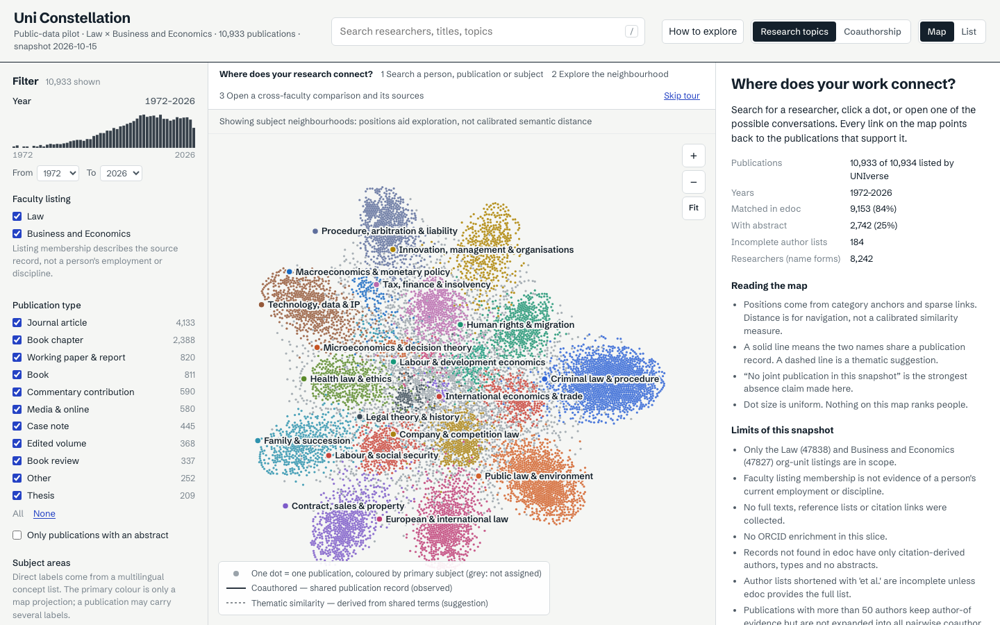
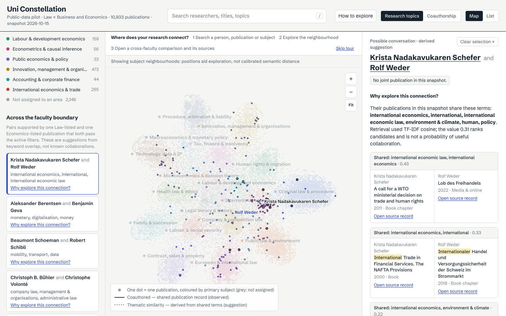
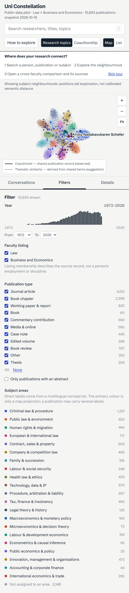

# Validation

Results for the combined snapshot built and reviewed on 2026-10-15.

## Collection and combination

- Law: 7,807/7,807 records, 16 listing pages, no failed page, complete.
- Business and Economics: 3,127/3,127, 7 pages, no failed page, complete.
- One shared UNIverse ID; 10,933 combined unique records; both memberships/source records retained.
- 9,153 edoc matches: 9,110 handle, 4 DOI, 39 conservative title+year+author. 2,742 abstracts (25.1%).
- 361 total logical edoc requests; no cap reached. Economics collection used 114 network requests total and no failures.
- No record/enrichment conflicts. Identifier collisions on distinct UNIverse IDs are listed in `coverage.json` and deliberately remain separate.

## Automated checks

`npm test` under the NumPy environment runs 8 unit tests: 11 citation cases as subtests, identity rules, shared-ID combination/provenance, and explicit missing-source reporting. `scripts/validate.py` reports:

```text
validated 10933 publications, 8242 researchers, 74236 edges, 32 suggestions
OK: no dangling references; all relationships carry evidence
```

Validation additionally asserts every suggestion's evidence is an exclusive Law↔Economics publication pair. Two consecutive graph/layout builds are byte-identical. The clean-checkout CI failure was reproduced from run `38780272746`: `.cache/layout-input.json` was written before its parent existed. `build_graph.py` now creates `.cache/` before writing.

`npm run build` passes TypeScript and Vite production compilation. Initial production JSON is 2.81 MiB gzip; publication details are 2.41 MiB gzip and lazy-loaded. Uncompressed build measurements are recorded by Vite: graph 10.16 MB, overview publications 12.16 MB, researchers 2.17 MB, layout 0.41 MB, details 11.89 MB.

Playwright against the production preview:

```text
10 passed
desktop: framing/map; search→researcher→publication/source; comparison evidence/source links;
mode labels; empty filters; list/subject; faculty+year URL restoration and evidence gating;
invalid deep link; unavailable abstract; canvas click and keyboard controls
mobile Pixel 7: map, panel tabs, comparison, filters, zero horizontal overflow
```

The faculty-only filter produces zero cross-faculty suggestions. Narrowing the period reduces `data-visible-coauthor-edges`, proving coauthor lines require in-filter shared evidence. Reload restores encoded period/faculty/type/abstract filters.

## Discovery-quality review

Twenty real candidates were reviewed in [CANDIDATE_REVIEW.md](CANDIDATE_REVIEW.md), with the same publication evidence scored by TF-IDF and multilingual embeddings. Results: 13 useful, 3 obvious, 3 misleading, 1 insufficient. The review includes cross-language, missing-abstract and generic-term failures. It explicitly searched for series/edition and namesake issues; no obvious namesake appeared in the 20, but this is not identity validation. Three useful examples were selected for the opening list. This is implementer review, not independent faculty-expert assessment.

## Visual evidence

Fresh screenshots captured by the passing production-browser suite and visually inspected:

| Desktop overview | Cross-faculty evidence | Pixel 7 |
|---|---|---|
|  |  |  |

The desktop overview has clear faculty filters, optional walkthrough, subject labels, legend and provenance caveat. The comparison keeps both publications and source links visible. On mobile, topic labels are hidden to prevent cluster-label collisions; selected people remain labelled. No horizontal overflow was observed.

## Remaining limitations

- No independent faculty-expert, screen-reader or dark-mode visual review.
- 74.9% of records lack abstracts; keyword and semantic retrieval may overvalue titles.
- Name-only identity ambiguity remains; current employment and discipline are not inferred.
- The 2.81 MiB gzip initial overview is improved but still material on slow mobile links.
- No deployment or GitHub Pages environment was tested.
